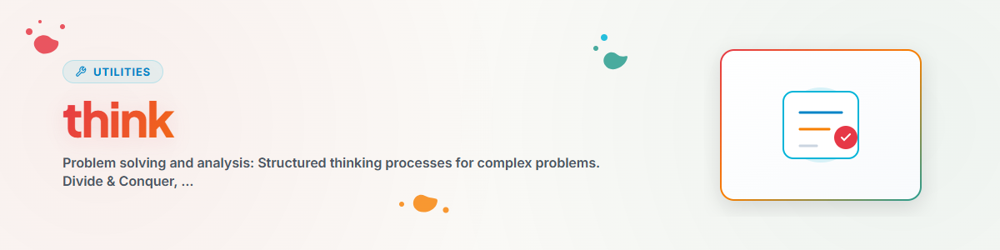

> **Русский** — Официальная русская версия `think`.


# Think — Решение проблем и анализ

> Процессы структурированного мышления для сложных проблем

---

## Подходы к решению проблем

### 1. Divide & Conquer (Разделяй и властвуй)

```
Problem -> Sub-problems -> Solve individually -> Combine
```

### 2. Root Cause Analysis (Анализ корневых причин)

```
Symptom -> Why? -> Why? -> Why? -> Root cause -> Solution
```

### 3. Constraint Relaxation (Ослабление ограничений)

```
Unsolvable problem -> Relax constraints -> Solve -> Re-apply constraints
```

### 4. Analogy Search (Поиск аналогий)

```
New problem -> Similar known problem -> Adapt solution
```

---

## Методы анализа

| Метод | Применение |
|-------|------------|
| **SWOT** | Сильные стороны / Слабые стороны / Возможности / Угрозы |
| **За/Против (Pro/Con)** | Принятие решений |
| **Pareto** | Приоритезация 80/20 |
| **Fishbone** | Анализ корневых причин (Диаграмма Исикавы) |

---

## Эвристики принятия решений

### В условиях неопределенности

```
1. Каков худший сценарий?
2. Обратимо ли это?
3. Какова цена бездействия?
```

### В условиях сложности

```
1. Каков самый простой первый шаг?
2. Что сделал бы эксперт?
3. Каким было бы решение на 80%?
```

---

## История изменений

### 1.1.0 (2026-11-06)
- Описание переписано с чётким триггером и разграничением (правило из docs/CONVENTIONS.md): ситуация применения, типичные формулировки пользователя и slash-команда в начале, соседние скиллы названы в оговорке «НЕ использовать».

### 1.0.0 (2026-03-15)
- Перенесено из BACH v3.8.0

---

*Перенесено из BACH v3.8.0 | Автономная версия*