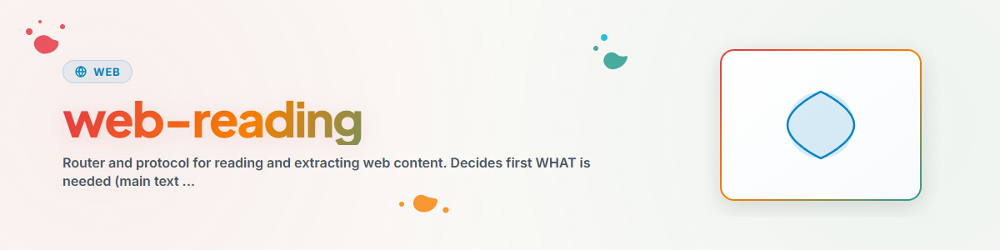

# قراءة صفحات الويب (موجّه)

## الغرض

جلب محتوى الويب ومعالجته، ولكن دون اختيار أداة بشكل أعمى.
تقوم هذه المهارة بالتوجيه: **أولًا الغرض، ثم أفضل أداة متاحة.**
يقع التنفيذ الفعلي في **وحدة `web-scraper`**؛ وتوضح هذه المهارة فقط ما هو متاح حاليًا وكيفية استخدامه.

## الخطوة 1 — ما المطلوب؟

```
Webseite verarbeiten?
  |
  +-- Haupttext (Artikel/Fließtext) → "Content"      → Schritt 2A
  +-- Links / Formulare / Headers   → "Struktur"     → Schritt 2B
  +-- Gerendertes Bild der Seite    → "Screenshot"   → Schritt 2C
```

## الخطوة 2 — أي أداة؟ (الموجّه)

استخدم **الأداة الأولى المتاحة** في القائمة المعنية. تعني "متاحة": أن الأداة أو المهارة أو الوحدة موجودة فعليًا في هذه الجلسة.

### 2A — المحتوى (النص الرئيسي، Markdown نظيف)

| الأولوية | الأداة | متاحة عندما … | الاستخدام |
|---|---|---|---|
| 1 | مهارة **`defuddle`** | المهارة `defuddle` مدرجة | Markdown نظيف من صفحات الويب العادية |
| 2 | الأداة المدمجة **`WebFetch`** | لدى الوكيل أداة WebFetch | قراءة سريعة أو تلخيص لعنوان URL |
| 3 | **`fc_web_fetch`** (MCP) | تم تحميل FileCommander-MCP | `mode: "extract"` |
| 4 | وحدة **`web-scraper`** | الوحدة مثبتة أو قابلة للاستيراد | `web-scraper extract <url>` أو `extract(url)` |

> ملاحظة: عناوين `.md` تكون بالفعل بصيغة Markdown، لذا تُستخدم مباشرة `WebFetch` دون مستخرِج.

### 2B — البنية (الروابط والنماذج والعناوين)

هنا لا تصلح `WebFetch`/`defuddle` (فهي تُرجع نصًا معالجًا، لا بنية خام). لذلك استخدم:

| الأولوية | الأداة | متاحة عندما … | الاستخدام |
|---|---|---|---|
| 1 | **`fc_web_fetch`** (MCP) | تم تحميل FileCommander-MCP | `mode: "links" \| "forms" \| "headers"` |
| 2 | وحدة **`web-scraper`** | الوحدة مثبتة أو قابلة للاستيراد | `web-scraper links\|forms\|headers <url>` |

### 2C — لقطة الشاشة

| الأولوية | الأداة | متاحة عندما … | الاستخدام |
|---|---|---|---|
| 1 | وحدة **`web-scraper`** | الوحدة مع إضافة `[screenshot]` | `web-scraper screenshot <url> --out bild.png` |
| 2 | أداة أتمتة المتصفح | مثل Playwright أو Computer-Use متوفرة | يعتمد على الصفحة |

## الخطوة 3 — البديل الاحتياطي: لم يُعثر على شيء مناسب؟

إذا لم تكن **أي** أداة متاحة للغرض، فاقترح تثبيت وحدة **`web-scraper`** (كاملة الإمكانات: get/links/forms/headers/extract/screenshot):

```bash
# aus dem lokalen Modulordner (.MODULES/.TOOLS/web-scraper)
pip install ".[http,extract]"          # + [screenshot] für Screenshots

# danach:
web-scraper extract <url>
```

كمكتبة:

```python
from web_scraper import WebScraper, extract
print(extract("https://example.com")["content"])
```

## الحل الاضطراري — مقتطف مستقل (بدون أي شيء)

إذا كانت المكتبة القياسية و`requests`/`bs4` فقط متاحة:

```python
import requests
from bs4 import BeautifulSoup

def extract_content(url: str) -> str:
    """Einfache Content-Extraktion."""
    response = requests.get(url, timeout=30)
    response.raise_for_status()
    soup = BeautifulSoup(response.text, "html.parser")
    for tag in soup(["script", "style", "nav", "header", "footer", "aside"]):
        tag.decompose()
    return soup.get_text(separator="\n", strip=True)
```

## سجل التغييرات

### 1.1.0 (2026-07-05)
- تحويل المهارة من بروتوكول نصي خالص إلى **موجّه**: يكتشف قدرات الويب الموجودة (`defuddle` و`WebFetch` و`fc_web_fetch` ووحدة `web-scraper`)، ويوجّه حسب الغرض (المحتوى/البنية/لقطة الشاشة)؛ وإلا يوصي بوحدة `web-scraper`.
- توحيد الاسم إلى `web-reading` (كان سابقًا بالألمانية `webseiten-lesen`).
- إزالة أمثلة BACH CLI من المتن (توافقًا مع وضع الاستقلالية (standalone)؛ ويبقى أصلها موثقًا في الفرونت ماتر `bach_integration`).

### 1.0.0 (2026-03-12)
- التصدير من سير عمل BACH v3.8.0 `webseiten-lesen.md`
