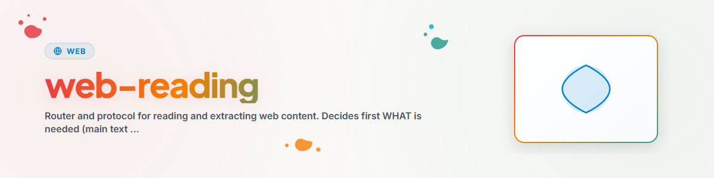

> **Français** — Version française officielle de la compétence `web-reading`.

# Lecture de pages web (Routeur)

## Finalité

Récupérer et traiter des contenus web — sans choisir un outil à l'aveugle. Cette compétence joue le rôle de routeur : **d'abord le besoin, ensuite le meilleur outil disponible.** L'implémentation proprement dite vit dans le **module `web-scraper`** ; cette compétence indique uniquement ce qui est disponible et comment l'utiliser.

## Étape 1 — De quoi a-t-on besoin ?

```
Traiter une page web ?
  |
  +-- Texte principal (article / corps) → "Content"      → Étape 2A
  +-- Liens / Formulaires / En-têtes    → "Structure"    → Étape 2B
  +-- Image rendue de la page           → "Screenshot"   → Étape 2C
```

## Étape 2 — Quel outil choisir ? (Routeur)

Prenez le **premier outil disponible** dans la liste correspondante. « Disponible » signifie que l'outil, la compétence ou le module est effectivement présent dans cette session.

### 2A — Contenu (texte principal, Markdown propre)

| Priorité | Outil | Disponible si … | Utilisation |
|---|---|---|---|
| 1 | Compétence **`defuddle`** | La compétence `defuddle` est listée | Markdown propre issu de pages web classiques |
| 2 | **`WebFetch`** intégré | L'agent dispose de l'outil `WebFetch` | Lecture/synthèse rapide d'une URL |
| 3 | **`fc_web_fetch`** (MCP) | MCP FileCommander chargé | `mode: "extract"` |
| 4 | Module **`web-scraper`** | Module installé/importable | `web-scraper extract <url>` ou `extract(url)` |

> Remarque : les URL `.md` sont déjà du Markdown → directement `WebFetch`, pas d'extracteur.

### 2B — Structure (liens, formulaires, en-têtes)

Ici `WebFetch`/`defuddle` ne conviennent **pas** (ils fournissent du texte mis en forme, pas la structure brute). Prenez donc :

| Priorité | Outil | Disponible si … | Utilisation |
|---|---|---|---|
| 1 | **`fc_web_fetch`** (MCP) | MCP FileCommander chargé | `mode: "links" \| "forms" \| "headers"` |
| 2 | Module **`web-scraper`** | Module installé/importable | `web-scraper links\|forms\|headers <url>` |

### 2C — Capture d'écran (Screenshot)

| Priorité | Outil | Disponible si … | Utilisation |
|---|---|---|---|
| 1 | Module **`web-scraper`** | Module avec l'extra `[screenshot]` | `web-scraper screenshot <url> --out image.png` |
| 2 | Outil d'automatisation navigateur | par ex. Playwright/Computer-Use présent | selon la page |

## Étape 3 — Solution de repli : rien d'adapté trouvé ?

Si **aucun** outil n'est disponible pour le besoin, recommandez l'installation du **module `web-scraper`** (complet : get/links/forms/headers/extract/screenshot) :

```bash
# depuis le dossier local du module (.MODULES/.TOOLS/web-scraper)
pip install ".[http,extract]"          # + [screenshot] pour les captures d'écran

# ensuite :
web-scraper extract <url>
```

En tant que bibliothèque :

```python
from web_scraper import WebScraper, extract
print(extract("https://example.com")["content"])
```

## Solution de secours — Extrait autonome (sans rien d'autre)

Si seules la bibliothèque standard + `requests`/`bs4` sont disponibles :

```python
import requests
from bs4 import BeautifulSoup

def extract_content(url: str) -> str:
    """Extraction de contenu simple."""
    response = requests.get(url, timeout=30)
    response.raise_for_status()
    soup = BeautifulSoup(response.text, "html.parser")
    for tag in soup(["script", "style", "nav", "header", "footer", "aside"]):
        tag.decompose()
    return soup.get_text(separator="\n", strip=True)
```

## Journal des modifications

### 1.1.1 (2026-11-22)
- Indication de langue corrigée

### 1.1.0 (2026-07-05)
- Refonte d'un simple protocole en **routeur** : détecte les capacités web disponibles (`defuddle`, `WebFetch`, `fc_web_fetch`, module `web-scraper`) et route selon l'usage (Contenu/Structure/Capture d'écran) ; recommande sinon le module `web-scraper`.
- Nom uniformisé sur `web-reading` (auparavant DE `webseiten-lesen`).
- Suppression des exemples BACH-CLI du corps (conforme autonome ; la provenance reste documentée dans le frontmatter `bach_integration`).

### 1.0.0 (2026-03-12)
- Export depuis le workflow BACH v3.8.0 `webseiten-lesen.md`
